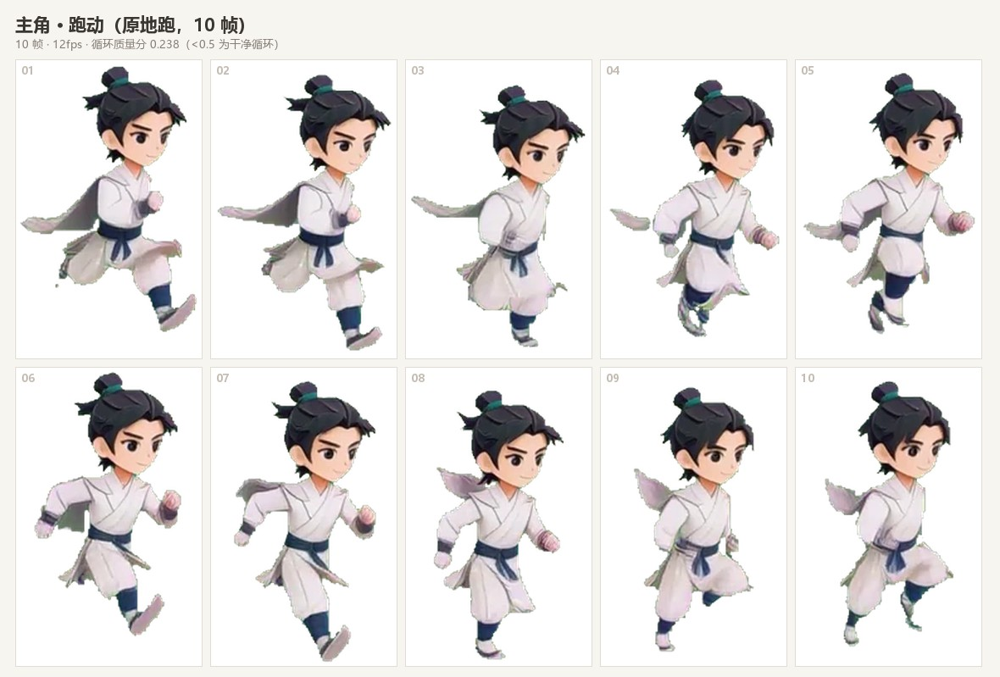
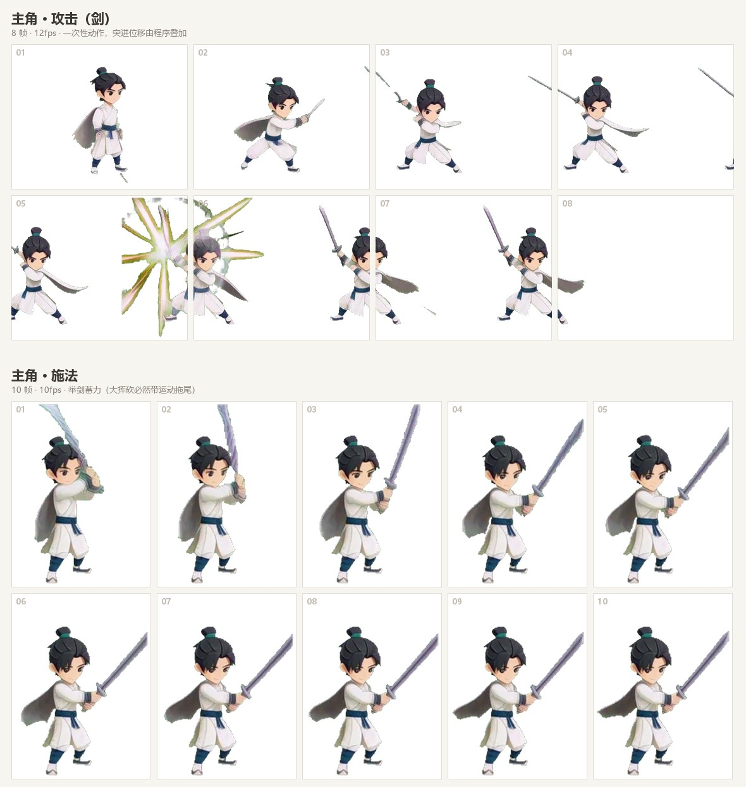
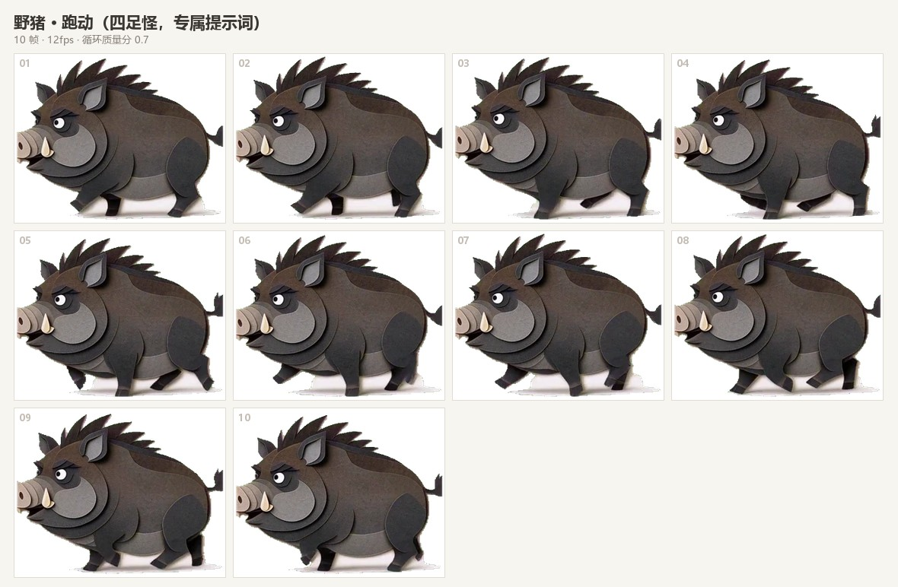
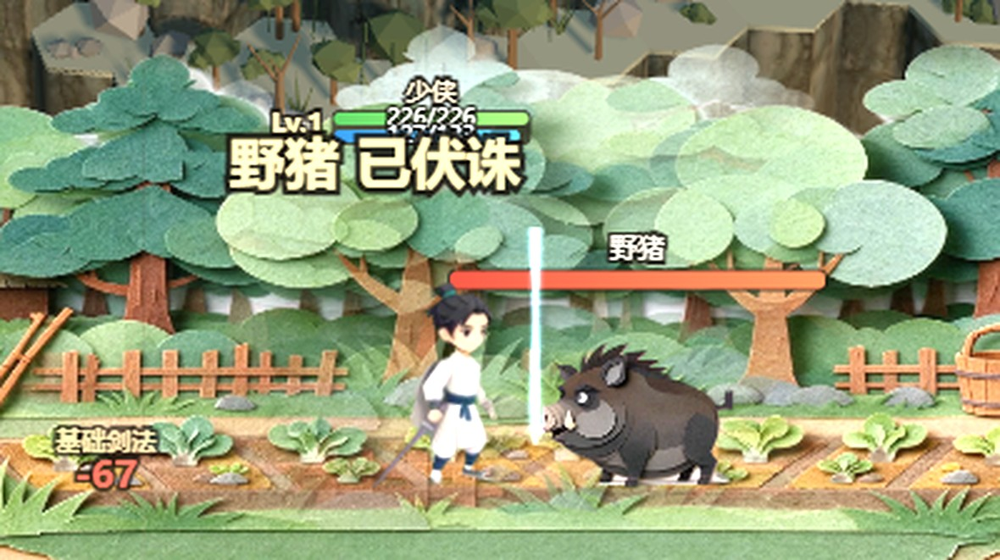

# sprite-action-forge · 动作精灵锻造

> **一张立绘 → 一整套游戏动作精灵表。全部本地跑（ComfyUI + MiniMax H3），8GB 显存即可。**
>
> Turn a single character illustration into a full set of 2D game action sprite sheets — locally, with MiniMax H3 + ComfyUI, on an 8GB GPU.

不需要云服务，不需要 4090。实测环境：**RTX 3070 Ti 8GB + 63.8GB 内存**，
448×448 / 39 帧 / Turbo 8 步 → **热启动 25.1 秒出片**，显存峰值 7505/8192 MiB。

---

## 效果

| 主角跑动（10 帧） | 主角攻击 + 施法 |
|---|---|
|  |  |

| 四足怪跑动（8 帧） | 接入游戏后的实机表现 |
|---|---|
|  |  |

---

## 它能干什么

- 有角色/怪物的**立绘或设定图**，要把它变成游戏里能播的动作（站立 / 跑动 / 走动 / 攻击 / 技能 / 挨打）
- 要做**攻击/技能特效**（刀光、落雷、冲击），而且要能和角色动画**分开调**
- 要把动作接进游戏：状态机、招式时序（动作播完才掉血）、位移、特效叠加

## 环境要求

| 依赖 | 说明 |
|---|---|
| ComfyUI | 本地服务（默认 `127.0.0.1:8188`）。`bash scripts/ensure_comfy.sh` 会自动找并补起。**需要 ≥ 0.31** |
| MiniMax H3 模型 | 放 ComfyUI 的 models 目录。**具体文件名见 `scripts/comfy_client.py` 顶部常量**（UNET/CLIP/VAE/TurboLoRA） |
| 8GB 显存 | 用 `--lowvram --disable-mmap` 启动 + KJNodes 的两个无损压显存节点 |
| Python | 需要 `numpy`、`Pillow` |
| ffmpeg | 抽帧用。优先 `pip install imageio-ffmpeg`；也支持随包放在 `_py/` 目录；或系统 PATH；或用 `SPRITE_FFMPEG=/path/to/ffmpeg` 指定 |

### 权重文件放哪

- `models/diffusion_models/` — `MiniMax_H3_FL2VA_pruned_mixed_int4_int8_convrot.safetensors`（原生 UNETLoader）
- `models/text_encoders/` — `qwen3vl_32b_minimax_h3_nvfp4_awq.safetensors`（原生 CLIPLoader，type=`minimax`）
- `models/vae/` — `minimax_h3_video_vae_fp16.safetensors` + `minimax_h3_audio_vae_fp32.safetensors`
- `models/loras/` — `minimax_h3_fl2v_turbo_8step_v1.0_comfyui_bf16.safetensors`（strength 1.0）

⚠️ **H3 的 GGUF 一律别用**：ComfyUI-GGUF 的架构白名单里没有 H3，扩散模型 GGUF 必然报
`Unknown model architecture!`。DiT 和文本编码器都必须用 safetensors 量化版 + 原生加载器。

## 三步走

```bash
# 0) 起服务（有则什么都不做）
bash scripts/ensure_comfy.sh

# 1) 角色动作（每个动作一条精灵表 + 一份 meta）
python scripts/sprite_forge.py \
  --art 少侠.png --char hero \
  --actions idle,run,attack,skill,hurt \
  --out ./_gen_actions \
  --style "crisp stylized cel-shaded chibi wuxia boy"

# 怪物换风格描述即可（写法见 references/prompts.md）
python scripts/sprite_forge.py --art 野猪.png --char mob_boar \
  --actions idle,run,attack,hurt --style "clean papercraft cut-out style"

# 2) 攻击/技能特效（独立素材）
python scripts/fx_forge.py --all --out ./_gen_actions/fx

# 3) 装配进 web 目录 + 生成清单（会自动备份被覆盖的原文件）
python scripts/install_sheets.py --src ./_gen_actions --dest ./public/assets/actions \
  --fx-src ./_gen_actions/fx --fx-map '{"attack":"slash","skill":"burst"}'
```

**只重跑后半段**（视频还在、只想改对齐/选窗）：加 `--reuse-video`，几秒钟一个，不花 GPU 时间。

## 配方速查

| 动作 | 时长 | 帧/帧率 | 说明 |
|---|---|---|---|
| idle | **2.0s** | 8 @6fps | 循环。呼吸/微动 |
| walk / run | **2.0s** | 10 @10-12fps | 循环，**必须原地跑**（提示词要写 treadmill） |
| attack | 1.0s | 8 @12fps | 一次性。提示词带 `no_fx` |
| skill | 1.5s | 10 @10fps | 一次性 + 取尾段选窗。提示词带 `no_fx` |
| hurt | 0.7s | 6 @12fps | 一次性 |

🔴 **循环动作一定要给够时长（≈2 秒）**：1 秒（39 帧）两端被起停包络占满、没有稳定的中段循环窗，
实测质量分 1.16（WEAK）；给到 2 秒（56 帧）后同一动作拿到 0.32（CLEAN）。

## 输出

```
_gen_actions/<char>_<action>.webp   精灵表（每帧等宽、内容不裁、跨动作人物等高）
_gen_actions/<char>_<action>.json   meta：帧数/fps/loop/content_h_ratio/baseline_ratio/选窗质量
```

**循环质量分**（meta 的 `window.score`）：`<0.5` 干净 ✅ / `0.5~0.8` 看一眼 ⚠️ / `>0.8` 步幅超出窗 ❌
（加长 `--seconds` 或重新生成）

## 五条铁律（不看会踩坑）

1. **帧几何要"算出来不裁"，不能试出来** —— 画布尺寸由内容实际伸展范围反推 + 上下对称留白。
   详见 `references/geometry.md`。症状：**人物只显示一半**。
2. **`center` 按动作区分** —— 循环类逐帧居中（消漂移）；一次性类整段平移（**保留前冲位移**，
   居中会把位移压平）。
3. **怪物必须给专属提示词** —— 通用的"站着呼吸"用在四足/纸雕怪上，模型会生成**静止插画**
   （逐帧像素几乎一样）。措辞要具体到身体部位。见 `references/prompts.md`。
4. **特效一律独立成精灵**，别烘进角色帧 —— 会把单帧宽度撑大（实测 322px vs 站立 174px），
   而且没法单独调位置/时长。
5. **比例以最终素材为准** —— 装配时从实际 webp 重量 `content_h_ratio`/`baseline_ratio`，
   别信生成时的 meta（素材会被重生成/回退）。否则人物会突然变大变小、脚悬空。

## 目录

```
SKILL.md                 技能说明（如果你在用支持 Skill 的 agent，读这个）
references/pipeline.md   完整流水线与每一步的原理
references/prompts.md    提示词库与措辞技巧（人物/怪物/特效）
references/geometry.md   帧几何与对齐算法
references/integration.md 游戏侧接入（状态机、招式时序、特效叠加）
references/pitfalls.md   踩坑清单（现象 → 根因 → 修法）
scripts/sprite_forge.py  主流程：立绘 → 精灵表
scripts/fx_forge.py      特效精灵
scripts/comfy_client.py  MiniMax H3 的 ComfyUI HTTP 客户端
scripts/loop_check.py    循环质量检测
scripts/install_sheets.py 装配 + 生成清单
```

## 排查

先看 `references/pitfalls.md`（按**现象**查因）。最常见的三个：

| 现象 | 大概原因 |
|---|---|
| 人物只显示一半 / 缺一块 | 对齐时内容被裁（画布尺寸没由内容反推） |
| 人物在攻击那几帧整个不画 | 坐标算出了 `NaN`（目标 `x` 是 undefined），绘制处要挡一道 `Number.isFinite` |
| 动画卡住不动 | 触发判成了电平；或主循环某帧抛错（先看 console 的 `pageerror`） |

## License

MIT。见 `LICENSE`。

⚠️ 注意：**MiniMax H3 是开放权重但不是 OSI 开源**。本仓库只包含工具代码；
你用 H3 生成的素材若要进商业产品，需要自行确认 MiniMax 的许可条款
（含界面标注要求与年收入门槛）。
